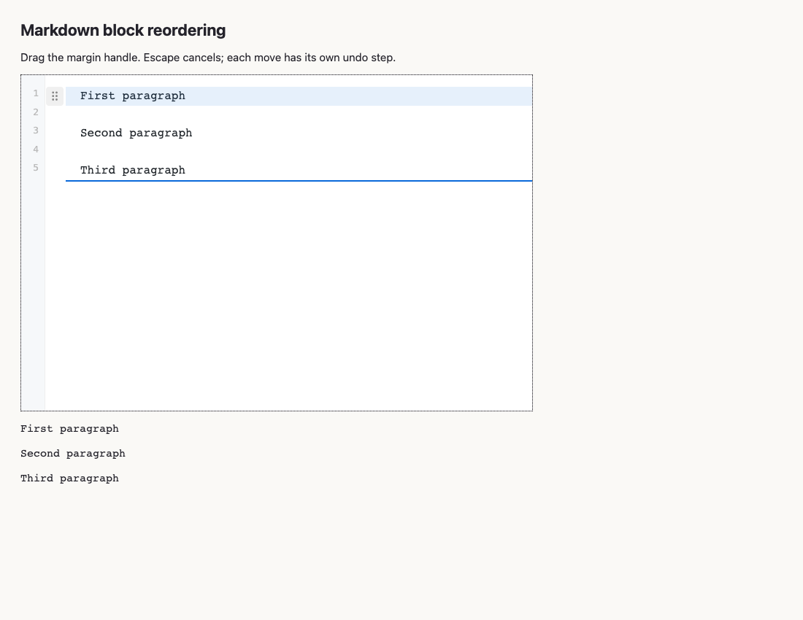
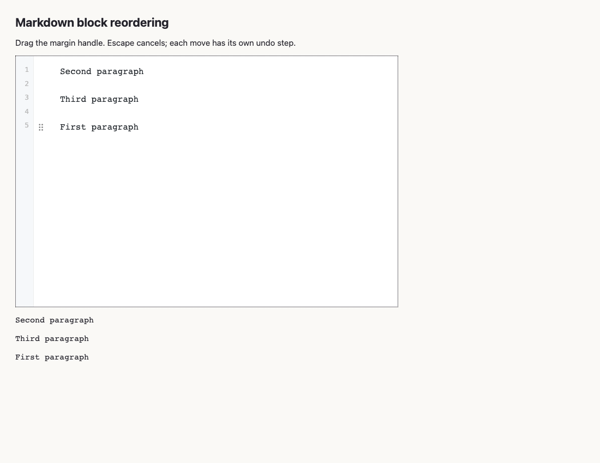

# Validation record

This is a Draft contribution. The implementation, tests, and documentation were primarily generated by AI. Maintainer approval and the unchecked acceptance items in [tasks.md](tasks.md) remain pending.

## Automated checks

| Check | Recorded result |
| --- | --- |
| Repository Vitest suite | 72 files, 1,043 tests passed |
| Repository type checks | Passed |
| Public API checks | Passed |
| Package build | Passed |
| Electron demo build | Passed |
| Existing Electron multi-window smoke | Passed |
| Strict OpenSpec validation | Passed |

These checks passed on the final code changes on 2026-09-17. The existing Electron multi-window smoke also passed. Manual acceptance items remain separate below.

## Browser smoke

The Playwright smoke script completed **92 document/scroll assertions** with screenshots enabled (91 without screenshots) in source and live-preview modes, with additional focus, visibility, rejection, and browser-error assertions. The final script-cleanup run also passed with screenshots enabled: **92 document/scroll assertions**, including the extra screenshot-path release check. It exercised:

- Beginning/end movement, undo, and redo for paragraphs, headings, quotes, nested lists, fenced code, indented code, thematic breaks, tables, and image paragraphs.
- Escape cancellation, CSS zoom factors 0.75 and 1.5, retained handle focus, and consecutive Up/Down keyboard movement.
- Read-only handle suppression, disabling the plugin during a gesture, auto-scroll through 100 paragraphs, and stopping scroll after cancellation.
- Rejected table input remaining available, successful retry, and undoing movement independently of the accepted cell edit.

The script uses a real headless Chrome renderer with automated pointer and keyboard input. It does not establish physical input-device or native OS IME behavior. Setting `BLOCK_DRAG_SCREENSHOT` also saves the active drag and completed layout, with one additional document assertion after release.

The additional `edge-smoke.mjs` completed **20 document assertions** plus geometry and lifecycle checks. It covers release outside the editor, loss of actual browser pointer capture, resizing, folded headings, folding during a gesture, horizontal overflow, and the existing table interaction matrix (editing, range/column selection and deletion, outside deselection, row/column reorder, and editing after whole-table movement). This acceptance found a horizontal-scrolling defect: long source lines scrolled the block handle out of view. The handle and indicators now use the visible content edge, with unit and real-browser regression coverage.

The `runtime-smoke.mjs` completed **40 assertions** using actual browser keyboard events. It covers default, rebound, cleared, and conflicting hotkeys; routing to the focused editor; late editor attachment; disabling and re-enabling the plugin; and retention of hotkey preferences. Independent command cases select their starting block explicitly. This does not establish continuous cursor preservation when switching between editors; see the known limitation below.

### Captured UI





## Electron smoke

The actual Electron demo passed drag, undo, Escape cancellation, default movement shortcuts, moving a table with pending cell input, and undoing the table movement while retaining the accepted edit in both legacy and native-runtime modes. The smoke script waits for the active editor's ready handle after deferred vault restoration. It uses temporary user data and hides only its own test window with background throttling disabled: physical pointer events otherwise interfered with the automated gesture and correctly triggered lost-capture cancellation. These checks use Electron's renderer and automated input; physical input acceptance remains separate. Broader Electron table rejection/retry and shortcut configuration acceptance remain pending.

## Environment

| Component | Version |
| --- | --- |
| Operating system | macOS 26.6.2, arm64 |
| Chrome | 152.0.7977.84 |
| Electron | 35.7.5 |
| Playwright | 1.55.0 |
| Node.js | 23.7.0 |
| pnpm | 9.15.4 |

## Reproduction

From the repository root, start the browser fixture server:

```sh
apps/electron-demo/node_modules/.bin/vite --config vitest.config.ts \
  --host 127.0.0.1 --port 5178
```

In a second terminal:

```sh
node packages/plugin-block-drag/test/browser/smoke.mjs
node packages/plugin-block-drag/test/browser/edge-smoke.mjs
node packages/plugin-block-drag/test/browser/runtime-smoke.mjs
```

Playwright needs an installed Chromium browser. Optionally set `PLAYWRIGHT_CHROMIUM_EXECUTABLE_PATH` to a local Chrome/Chromium executable. `BLOCK_DRAG_URL` overrides the fixture origin. Rebuild before running the independent Electron script:

```sh
pnpm build:electron-demo
node packages/plugin-block-drag/test/browser/electron-smoke.mjs
```

## Remaining acceptance

Native Chinese/Japanese OS IME, physical mouse/trackpad use, OS-triggered pointer cancellation, and screen-reader output have not been manually verified. The browser table checks insert Unicode text but do not exercise a native input-method session. DOM tests cover composition and pointer cancellation but do not replace physical acceptance. Broader Electron table rejection/retry and shortcut configuration remain pending. Exact pending items are listed separately in [tasks.md](tasks.md).

## Known baseline limitation

In the two-editor browser fixture, moving a block Down/Up in the first editor, switching focus to the second editor, and moving its first block Down can reset the second editor's selection to position zero on the following frame. A consecutive Up command then has no preceding block to move past. The document move itself remains correct.

The selection reset was reproduced three times with the plugin enabled, three times with it disabled, and three times in a bare CodeMirror `EditorView` without Nexus or its runtime. With CodeMirror view 6.41.0 and the Chrome version above, its DOM observer applies a selection change after the document update. This PR does not change that baseline behavior. Runtime routing checks explicitly select each command's intended source; the single-editor consecutive handle-key checks remain separate.
