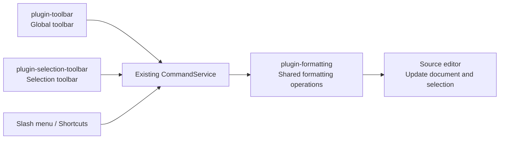

## Design overview

Show actions next to selected text. To enable the selection toolbar independently, separate three responsibilities: **formatting changes the document, the global toolbar provides a fixed entrypoint, and the selection toolbar provides a floating entrypoint.** Both UIs share formatting behavior; disabling them leaves commands and shortcuts available.

The diagram shows runtime calls. `plugin-formatting` registers formatting commands with the existing `CommandService`.

**The selection plugin depends on neither sibling.** The host supplies buttons and command IDs, including actions from other plugins. Both modes also accept direct host callbacks, including the demo-owned color picker. Callbacks receive their source button and abort signal to anchor and clean up pending UI.

## Core changes

| Area | Change |
| --- | --- |
| Add `plugin-formatting` | Extract formatting functions, default shortcuts, and color decorations from the original toolbar. Register canonical `formatting:*` commands without mounting UI. |
| Keep `plugin-toolbar` | Preserve the global UI and use shared formatting. Keep existing function exports and `toolbar:*` commands compatible. |
| Add `plugin-selection-toolbar` | Own selection handling, floating positioning, buttons, and cleanup. Create one instance per editor, with host-configured buttons. |
| Extend the existing command service | Accept an optional `AbortSignal`; check cancellation and registration before invocation to prevent stale work after document switches or unload. |
| Update host integration | Load formatting first and enable each toolbar independently. Configure link, inline code, and a color picker in both legacy and runtime demo modes. |

## Key behavior

- **Show after selection completes.** Support one desktop body selection in source and live-preview modes. Exclude multiple ranges, tables, block code, read-only state, and IME composition.
- **Keep actions available.** Apply formatting and its final selection in one transaction. Adding inline-code markers around `world` leaves the text selected and the toolbar visible, ready to toggle back.
- **Keep explicit dismissal.** Escape closes the toolbar while preserving selected text; a new selection starts a new session. Document switches, reselection, and unload cancel pending work. Cancellation does not undo an action that already started.
- **Follow the selection.** Position above a single line or near the selection head for multiple lines. Flip and clamp at edges; hide when the anchor is offscreen. Each instance owns its focus handling and cleanup.

## Compatibility

Reuse the existing command service, editor extensions, and plugin lifecycle without adding a framework or Core API. Preserve formatting exports, `createToolbarPlugin()`, and `toolbar:*` entrypoints. Migrate user shortcut preferences without duplicate bindings or palette entries.

Behavior contracts: [selection toolbar](specs/selection-toolbar/spec.md), [formatting](specs/formatting/spec.md), and [command service](specs/plugin-commands-events/spec.md).
