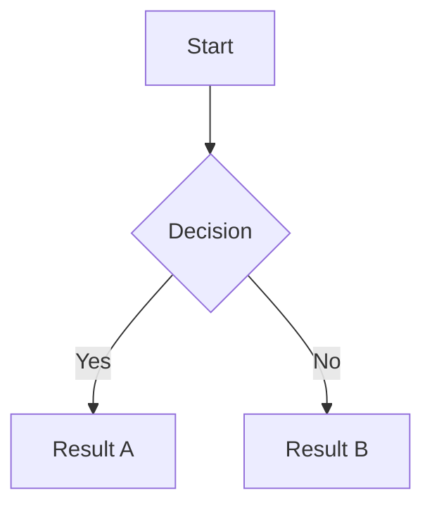

# @floatboat/nexus-plugin-mermaid

Renders [Mermaid](https://mermaid.js.org/) diagrams inside Nexus Editor's live-preview mode.

````markdown

````

The code block renders as a live SVG diagram when the cursor is outside it, and
reverts to editable source when the cursor moves inside (or when you click the
hover `✎` button).

## Installation

```bash
pnpm add @floatboat/nexus-plugin-mermaid
```

## Usage

```ts
import { createEditor } from "@floatboat/nexus-core";
import { createGfmPreset } from "@floatboat/nexus-preset-gfm";
import { createMermaidPlugin } from "@floatboat/nexus-plugin-mermaid";

const editor = createEditor({
  container: document.getElementById("editor")!,
  plugins: [createGfmPreset(), createMermaidPlugin()],
  livePreview: true,
});
```

## API

### `createMermaidPlugin(options?)`

Returns a `NexusPlugin` that activates Mermaid diagram rendering.

| Option | Type | Default | Description |
|---|---|---|---|
| `theme` | `"default" \| "dark" \| "neutral" \| "forest"` | auto-detect | Mermaid colour theme. When omitted, the plugin checks for the `nexus-dark` CSS class on `<html>` and the `prefers-color-scheme` media query. |

## Slash command

Type `/mermaid` in the editor to insert a starter flowchart template.

## Features

- **Live SVG rendering** — `graph`, `sequenceDiagram`, `gantt`, `pie`, `classDiagram`, and all other Mermaid diagram types.
- **Consistent UX** — hover the diagram to reveal a `✎` edit button, identical to the `plugin-math` affordance.
- **Auto dark/light theme** — follows the editor's active colour scheme without any configuration.
- **Graceful error display** — invalid diagram syntax shows a styled error block with the raw source preserved.
- **`/mermaid` slash command** — inserts a ready-to-use flowchart template at the cursor.
- **Accessibility** — the diagram container carries `aria-label="Mermaid diagram"`.
